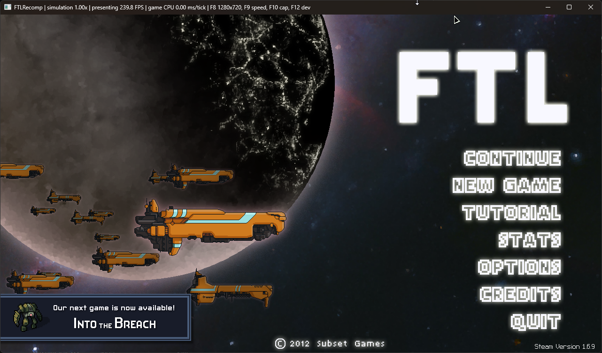
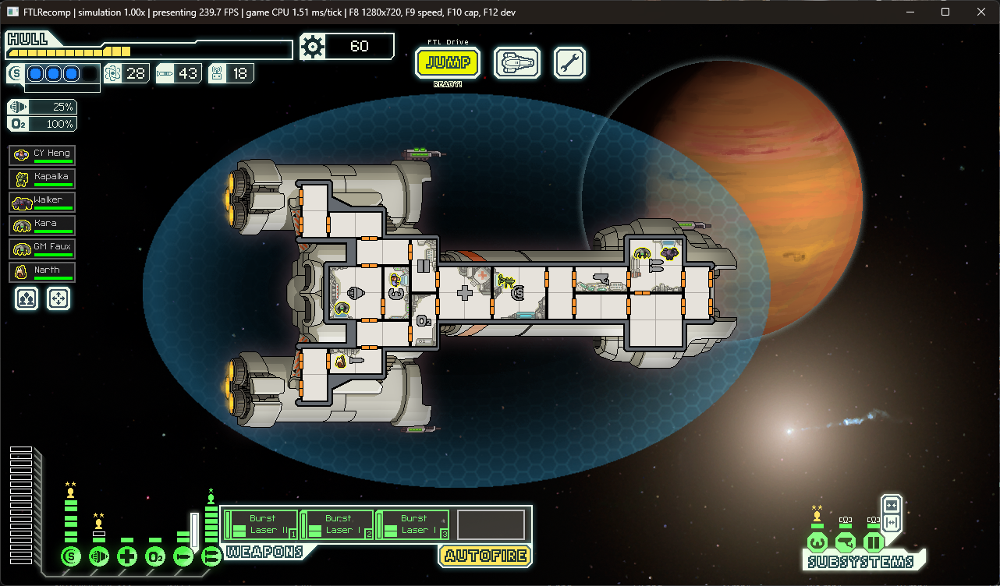
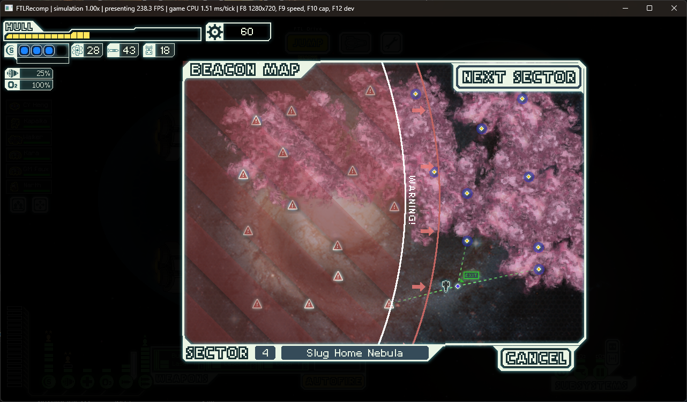
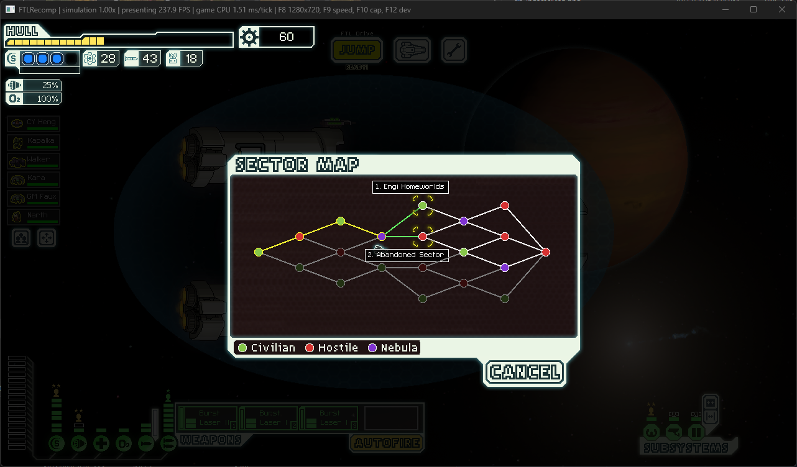

# FTL-Recompiled
Faster than light recompiled in c++

All features are implemented but there are still some bugs presents

- Sounds
- Combat
- Ships
- Achivements (ingame)
- VFX
- Crew
- Shops
- Events
- Environmental effects

Addtional features
------
- Fps goes up to 240fps
- Speed up to 10x
- Rendering unlinked from simulation

Screenshots
------

